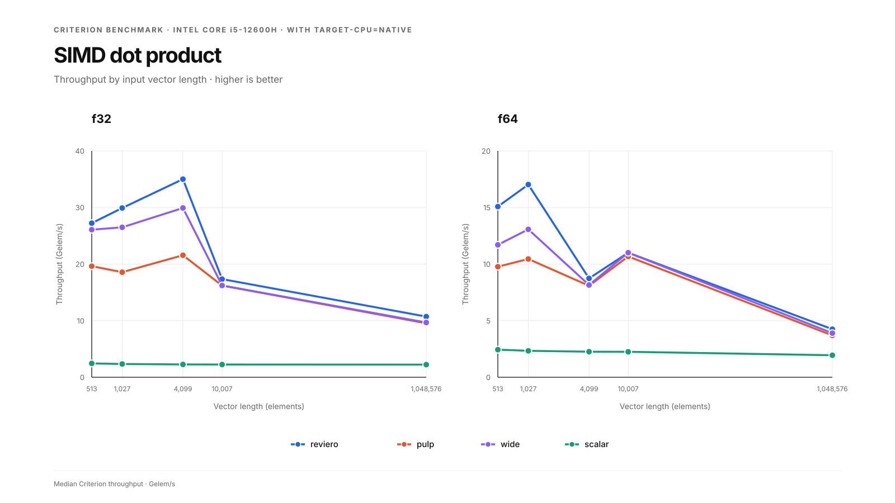
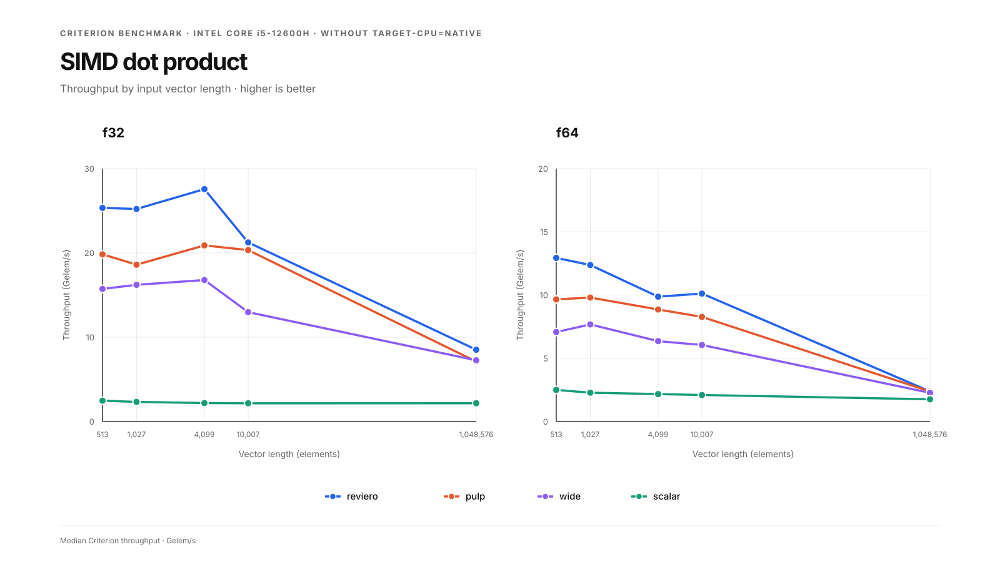
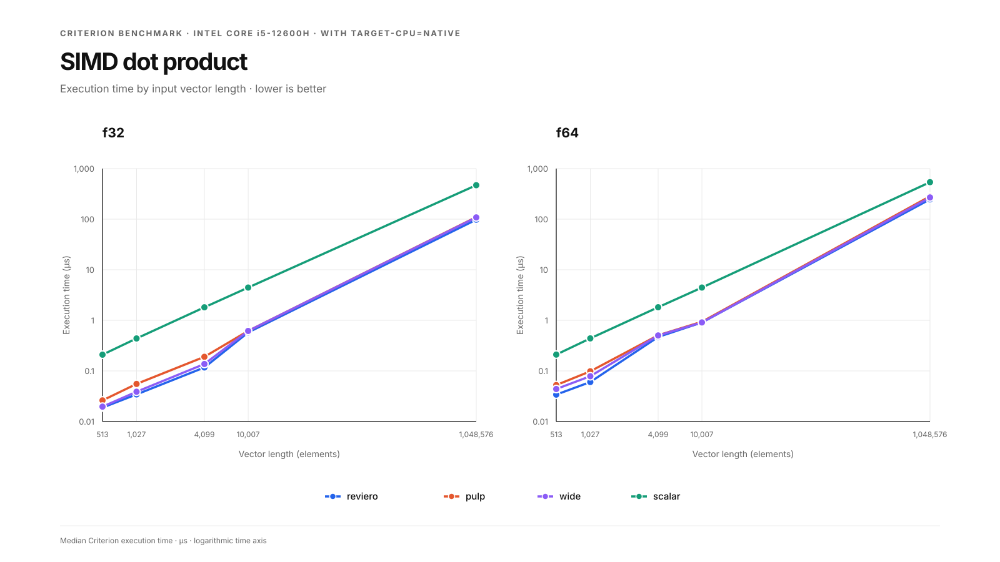
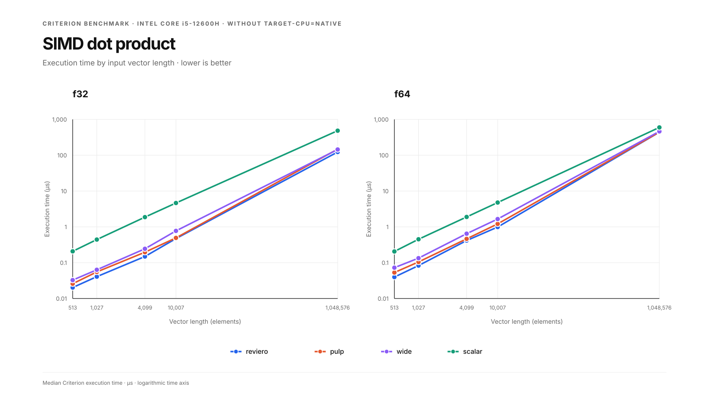

# reviero

[](#)
[](LICENSE)

**Safe and cross-platform SIMD for Rust.**

`reviero` provides portable SIMD operations with runtime CPU dispatch, allowing the same code to run across different architectures and instruction sets.

## Installation

Add `reviero` to your `Cargo.toml`:

```toml
[dependencies]
reviero = "0.1"
```

## Usage

### Manual Vectorization

`reviero` provides a low-level SIMD interface that allows you to implement vectorized operations manually while keeping the implementation portable across supported architectures.

The following example implements a vectorized sum:

```rust
pub struct Sum<'a>(&'a [f32]);

impl<'a> reviero::SimdFn for Sum<'a> {
    type Result = f32;

    #[inline(always)]
    fn call<S: reviero::traits::Simd>(self, simd: S) -> Self::Result {
        let (head, tail) = reviero::utils::as_simd_f32s(&simd, self.0);

        let mut sum = simd.splat_f32(0.0);

        for vector in head {
            sum = simd.add_f32(sum, vector);
        }

        let mut sum = simd.reduce_sum_f32(sum);

        for &x in tail {
            sum += x;
        }

        sum
    }
}

fn main() {
    let x = [1.0, 2.0, 3.0, 4.0, 5.0, 6.0, 7.0, 8.0, 9.0, 10.0];
    let sum = reviero::dispatch(Sum(&x));
    println!("sum: {sum}");
}
```

`SimdFn::call` must be marked `#[inline(always)]`. This lets the selected backend's target features propagate into the operation and allows its vector instructions to be inlined; without it the operation stays correct, but may lose most of the performance benefit.

### Runtime Dispatch

`reviero::dispatch()` automatically selects an appropriate SIMD implementation based on the capabilities of the current CPU.

## Benchmarks

Criterion dot-product benchmarks on an Intel Core i5-12600H. Each chart compares `reviero`, `pulp`, `wide`, and `scalar` across `f32` and `f64` inputs, from 513 to 1,048,576 elements.

### Throughput

Higher is better. Throughput is shown in billions of elements per second (Gelem/s).

| With `target-cpu=native` | Without `target-cpu=native` |
|:--:|:--:|
|  |  |

### Execution time

Lower is better. Median execution time is shown in microseconds on a logarithmic scale.

| With `target-cpu=native` | Without `target-cpu=native` |
|:--:|:--:|
|  |  |

The native run uses `RUSTFLAGS="-C target-cpu=native"`; the default-target run does not set `target-cpu`. See the raw Criterion output for the [native run](assets/raw_bench.i5-12600h.txt) and the [default-target run](assets/raw_bench_no_native.i5-12600h.txt).
